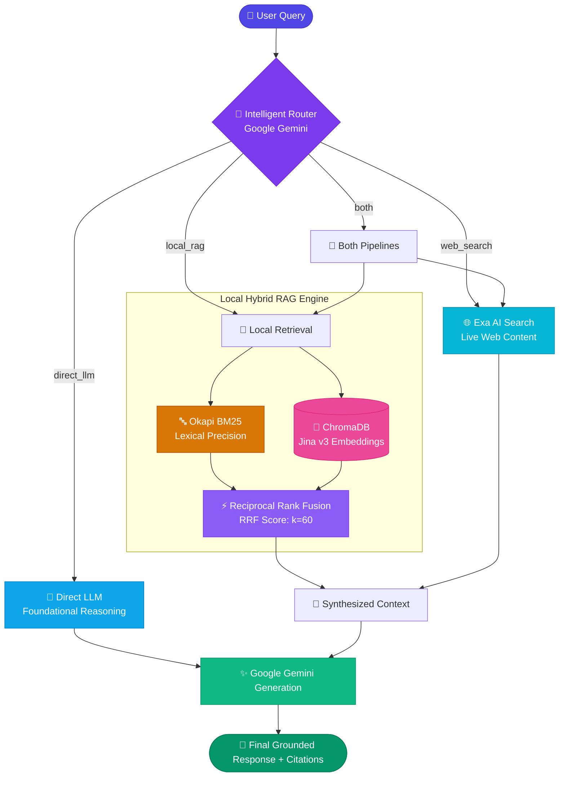

<div align="center">

# 🧠 Intelligent GenAI Knowledge Assistant

### Multi-Route Query Router • Hybrid RAG (BM25 + ChromaDB) • Live Web Search • AGUI Dashboard

[](https://www.python.org/)
[](https://fastapi.tiangolo.com/)
[](https://aistudio.google.com/)
[](https://www.trychroma.com/)
[](https://github.com/sathishatgit/genai-knowledge-assistant/pulls)
[](https://www.linkedin.com/in/sathishbabu-shanmugam/)

<p align="center">
  <b>Developed with ❤️ by <a href="https://www.linkedin.com/in/sathishbabu-shanmugam/">Sathish</a> (AI Engineer)</b>
</p>

[Key Features](#-key-features) •
[Architecture](#-target-architecture) •
[The 4 Routes](#-the-4-intelligent-routes) •
[Quickstart](#-quickstart-guide) •
[API Keys Setup](#-api-keys--env-configuration) •
[AGUI Dashboard](#-agui-interactive-web-dashboard) •
[Contributing](#-contributing--pull-requests)

---

</div>

## 📌 Executive Summary

Most RAG implementations force **every single user prompt** through a fixed embedding and retrieval pipeline. In production, this causes:
- ❌ **Latency spikes** on simple questions like *"How do I sort a list in Python?"*
- ❌ **Context poisoning** from injecting irrelevant company memos into coding prompts
- ❌ **Information staleness** when users ask about real-time events or today's news

The **Intelligent GenAI Knowledge Assistant** solves this through a **Decoupled Decision Engine**: it inspects query intent first, then dynamically dispatches to **Direct LLM reasoning**, **Local Hybrid RAG**, **Live Neural Web Search**, or a **Synthesized Dual Pipeline**.

---

## ⚡ Key Features

| Capability | Technology | Description |
|---|---|---|
| **Intelligent Routing** | `Google Gemini 1.5 Flash` | Autonomous 4-route classifier with strict JSON output & heuristic fallback |
| **Lexical Keyword Search** | `Okapi BM25` | Exact-match retrieval for technical acronyms, codes, and IDs |
| **Dense Vector Search** | `Jina AI v3 + ChromaDB` | 1024-dim neural semantic search stored locally without Docker |
| **Rank Fusion** | `Reciprocal Rank Fusion (RRF)` | Blends lexical & semantic rankings using standard $k=60$ smoothing |
| **Live Web Search** | `Exa AI Neural Search` | Fetches real-time, authoritative internet sources with page contents |
| **Resilient Generation** | `Gemini Multi-Model Fallback` | Multi-model quota chain iterating across Flash & Preview variants on rate limits |
| **Live AGUI Dashboard** | `FastAPI + TailwindCSS` | Single-page real-time pipeline visualizer with instant in-browser ingestion |
| **Dynamic Ingestion** | `Zero-Downtime Indexing` | Upload `.txt` files or paste text in the UI with immediate live searchability |

---

## 🏗️ Target Architecture



---

## 🚦 The 4 Intelligent Routes

The Decision Engine evaluates query intent and dispatches to one of four distinct paths:

```
┌────────────────────────────────────────────────────────────────────────┐
│                        USER INPUT: "What is RAG?"                      │
└───────────────────────────────────┬────────────────────────────────────┘
                                    │
                                    ▼
┌────────────────────────────────────────────────────────────────────────┐
│              ROUTER CLASSIFIES INTENT (Returns JSON)                   │
├────────────────────┬────────────────────┬──────────────────────────────┤
│ Route              │ Trigger Scenario   │ Data Sources Consulted       │
├────────────────────┼────────────────────┼──────────────────────────────┤
│ 🧠 direct_llm      │ General knowledge  │ None (Pure model reasoning)  │
│ 📂 local_rag       │ Internal documents │ Local BM25 + ChromaDB Vectors│
│ 🌐 web_search      │ Real-time & news   │ Exa AI Live Web Crawler      │
│ 🔄 both            │ Comparative study  │ Local Docs + Web Synthesized │
└────────────────────┴────────────────────┴──────────────────────────────┘
```

### Route Breakdown & Examples:

| Route | When It Triggers | Data Retrieved | Example Query |
|---|---|---|---|
| 🧠 **`direct_llm`** | Programming syntax, algorithms, math, general logic | **Zero retrieval** (Instant generation) | *"How do dictionary comprehensions work in Python?"* |
| 📂 **`local_rag`** | Proprietary documents, internal system architecture, company files | Local chunks via **BM25 + ChromaDB** | *"According to our internal docs, what is our system design?"* |
| 🌐 **`web_search`** | Today's news, latest model benchmarks, external library releases | Live internet via **Exa AI API** | *"What are the latest AI models released this week?"* |
| 🔄 **`both`** | Comparing internal architectures against external industry standards | **Both** Local Docs + Live Web fused | *"Compare our internal RAG pipeline with latest industry trends."* |

---

## 💻 AGUI Interactive Web Dashboard

The application includes a clean single-page interactive UI running directly on FastAPI.

```text
┌────────────────────────────────────────────────────────────────────────────────────────┐
│  🧠 AGUI Agent Hub    [Gemini: Ready] [Jina: Ready] [Exa: Ready] [Chunks: 22]          │
├────────────────────────────────┬───────────────────────────────────────────────────────┤
│  📂 INDEXED KNOWLEDGE          │  💬 INTERACTIVE WORKSPACE                             │
│  • python.txt (1,420 chars)    │  [ Preset Buttons: Direct | Local | Web | Both ]      │
│  • generative_ai.txt           │  ┌──────────────────────────────────────────────────┐ │
│  • machine_learning.txt        │  │ Ask anything... (Auto-routes or force route)     │ │
│  • rag.txt                     │  └──────────────────────────────────────────────────┘ │
│  • Sathish.txt                 │                                                       │
│                                │  ⚡ Real-Time Pipeline Tracker:                       │
│  [➕ Add Knowledge Data]       │  [✓ Router] ➔ [✓ Hybrid Search] ➔ [✓ Gemini Synthesizer]
│  [🔄 Re-Index Store]           │  📑 Answer with Expandable Citations & Source Badges   │
└────────────────────────────────┴───────────────────────────────────────────────────────┘
```

### Dashboard Capabilities:
- 🚀 **Real-Time Pipeline Stepper**: Watch the step-by-step progress from Intent Classification ➔ Retrieval ➔ Rank Fusion ➔ Response Generation.
- 📂 **Instant Dynamic Ingestion**: Add new custom knowledge via direct text paste or `.txt` file upload without restarting the server.
- 🎯 **One-Click Presets**: Pre-configured query buttons for evaluating all 4 routing paths instantly.
- 🏷️ **Transparent Citations**: Expandable source panels showing matched document names, similarity scores, and live web URLs.

---

## 🚀 Quickstart Guide

### 1. Clone the Repository
```bash
git clone https://github.com/sathishatgit/genai-knowledge-assistant.git
cd genai-knowledge-assistant
```

### 2. Set Up Virtual Environment

> [!TIP]
> Use Python 3.10, 3.11, or 3.12 for best compatibility.

**Windows (PowerShell):**
```powershell
python -m venv venv
.\venv\Scripts\Activate.ps1
```

**macOS / Linux:**
```bash
python3 -m venv venv
source venv/bin/activate
```

### 3. Install Dependencies
```bash
pip install --upgrade pip
pip install -r requirements.txt
```

---

## 🔑 API Keys & `.env` Configuration

This project requires **3 free API keys** (all provide free tiers without requiring a credit card):

| Service | Provider Link | Free Tier Limits | Environment Variable |
|---|---|---|---|
| **Google Gemini** | [Google AI Studio](https://aistudio.google.com/) | 15 RPM / 1M tokens per day | `GEMINI_API_KEY` |
| **Jina AI** | [Jina AI Embeddings](https://jina.ai/) | 1,000,000 tokens free on signup | `JINA_API_KEY` |
| **Exa AI** | [Exa AI Search](https://exa.ai/) | 1,000 free searches per month | `EXA_API_KEY` |

### Step-by-Step Configuration:

1. Create your local `.env` file from the example template:
   ```bash
   # Windows
   copy .env.example .env

   # Linux / macOS
   cp .env.example .env
   ```

2. Open `.env` and fill in your keys:
   ```ini
   # Google Gemini API Key (https://aistudio.google.com/)
   GEMINI_API_KEY=your_gemini_api_key_here

   # Jina AI Embeddings API Key (https://jina.ai/)
   JINA_API_KEY=your_jina_api_key_here

   # Exa AI Web Search Key (https://exa.ai/)
   EXA_API_KEY=your_exa_api_key_here

   # Model Defaults
   GEMINI_MODEL=gemini-1.5-flash
   JINA_EMBEDDING_MODEL=jina-embeddings-v3
   ```

3. **Verify Your Setup:**
   ```bash
   python check_setup.py
   ```
   *Checks Python version, package imports, API key existence, and local ChromaDB health.*

---

## 🏃 Running the Application

### Option A: Modern Web Dashboard (Recommended)
```bash
python app.py
```
Open your browser at:  
👉 **`http://localhost:8000`**

### Option B: Interactive Terminal CLI
```bash
python main.py
```

### Option C: Single-Query CLI Mode
```bash
# Auto-routed query
python main.py --query "What is a Python generator?"

# Forcing a specific route
python main.py --query "What is our internal system design?" --route local_rag
```

---

## 📥 Ingestion Pipeline

To index the seed documents in `data/documents/`:
```bash
python ingest.py
```

**What the pipeline does:**
1. Loads all `.txt` documents from `data/documents/`.
2. Chunks documents into 400-character segments with 80-character overlap.
3. Generates 1024-dimensional semantic vectors via Jina AI API (`jina-embeddings-v3`).
4. Stores vectors and text in persistent local ChromaDB (`data/chroma/`).
5. Generates and serializes the Okapi BM25 lexical index to `data/bm25_index.json`.

---

## 🔬 Core Algorithms Deep Dive

### 1. Hybrid Search with Reciprocal Rank Fusion (RRF)
Lexical BM25 scores (unbounded frequencies) and vector cosine similarities (bounded $[-1, 1]$) cannot be directly added. We implement **Reciprocal Rank Fusion (RRF)**:

$$\text{RRF Score}(d) = \sum_{m \in M} \frac{1}{k + \text{rank}_m(d)}$$

Where:
- $M = \{\text{BM25}, \text{ChromaDB Vector}\}$
- $k = 60$ (smoothing constant preventing outlier bias)
- $\text{rank}_m(d)$ is the 1-indexed rank of document $d$ in system $m$

### 2. Multi-Model Resilience Chain
If a primary Gemini model hits a transient rate limit (HTTP 429) or model unavailability, `src/gemini.py` automatically cascades across fallback candidates:
```text
Configured Model ➔ gemini-1.5-flash ➔ gemini-3.5-flash ➔ gemini-3.1-flash-lite
```

---

## 📁 Repository Structure

```text
genai-knowledge-assistant/
│
├── data/
│   ├── documents/              # Seed text knowledge documents
│   ├── chroma/                 # Local ChromaDB persistent store (git-ignored)
│   └── bm25_index.json         # Serialized Okapi BM25 index (git-ignored)
│
├── src/
│   ├── config.py               # Environment configuration & paths
│   ├── document_loader.py      # Plain-text document loader
│   ├── chunker.py              # Overlapping character chunker
│   ├── embeddings.py           # Jina AI Embeddings REST client
│   ├── vector_store.py         # Thread-safe ChromaDB singleton store
│   ├── bm25_search.py          # Okapi BM25 lexical search engine
│   ├── rrf.py                  # Reciprocal Rank Fusion implementation
│   ├── hybrid_search.py        # Hybrid BM25 + Vector coordinator
│   ├── exa_search.py           # Exa AI live web search client
│   ├── gemini.py               # Gemini generation client with multi-model fallback
│   ├── router.py               # Intent classification with heuristic fallback
│   ├── rag.py                  # End-to-end multi-route orchestrator
│   └── static/
│       └── index.html          # AGUI interactive web application
│
├── tests/                      # Comprehensive unit & E2E tests (Phases 2-15)
├── app.py                      # FastAPI server & REST API endpoints
├── ingest.py                   # Knowledge base ingestion CLI
├── main.py                     # Interactive terminal CLI
├── check_setup.py              # Workshop environment verification script
├── PROBLEM_STATEMENT.md        # Workshop student challenge document
├── requirements.txt            # Python dependencies
├── .env.example                # Sample environment file
└── README.md                   # Project documentation
```

---

## 🛠️ Troubleshooting

| Error | Root Cause | Fix |
|---|---|---|
| `Missing required API key: GEMINI_API_KEY` | Placeholder still present in `.env` | Paste your actual Gemini API key in `.env` |
| `HTTP 401 Unauthorized (Jina)` | Invalid or expired Jina key | Generate a fresh free key at [jina.ai](https://jina.ai/) |
| `HTTP 401 Unauthorized (Exa)` | Invalid Exa key | Retrieve your key from the [Exa dashboard](https://exa.ai/) |
| `ChromaDB count is 0` | Ingestion was run without valid keys | Ensure `.env` is populated and rerun `python ingest.py` |
| `BM25 index not found` | Ingestion hasn't run yet | Run `python ingest.py` or use **Re-Index** in the web UI |

---

## 🤝 Contributing & Pull Requests

This repository is completely public and open for exploration, learning, and improvement!

> [!NOTE]
> Direct pushes to `master` are protected. All contributions are welcomed through **Pull Requests (PRs)**:

1. **Fork the repository** to your personal GitHub account.
2. **Clone your fork:**
   ```bash
   git clone https://github.com/<your-username>/genai-knowledge-assistant.git
   cd genai-knowledge-assistant
   ```
3. **Create a descriptive feature branch:**
   ```bash
   git checkout -b feature/my-new-feature
   ```
4. **Make your improvements** and run tests:
   ```bash
   pytest tests/
   ```
5. **Commit and push** to your fork:
   ```bash
   git commit -m "feat: add support for PDF document ingestion"
   git push origin feature/my-new-feature
   ```
6. **Open a Pull Request** against `master` on the upstream repository.

---

## 👨‍💻 Author & Contact

<div align="center">

### **Sathish**
**AI Engineer**

[](https://www.linkedin.com/in/sathishbabu-shanmugam/)
[](https://github.com/sathishatgit)

*Built for hands-on Generative AI workshops, production architecture demonstrations, and student learning.*

⭐ **If you find this project helpful, please consider starring the repository!**

</div>
